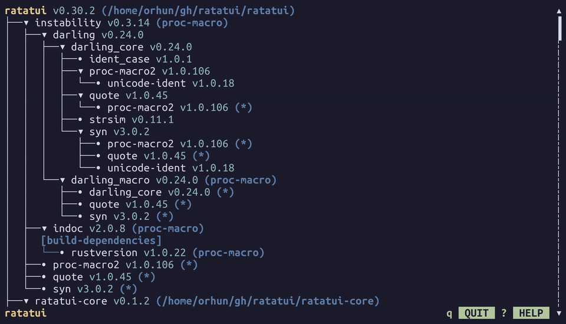

# cargo-tree-tui



## installation

```bash
cargo install cargo-tree-tui
# or
cargo install --git https://github.com/orhun/cargo-tree-tui.git
```

## usage

in the root of your cargo project:

```bash
cargo tree-tui
```

## talk

Conference talk: [There are rats in my Cargo!!! by Orhun Parmaksiz | Rustikon 2026](https://www.youtube.com/watch?v=8SLGAFgX-PA)

## license

MIT OR Apache-2.0
